# Crimson Veil

2.5D akční plošinovka v Unity 6.3 (URP). Pohyb a boj ve stylu *Prince of Persia: The Lost Crown*, atmosféra a vyprávění beze slov ve stylu *Limbo*.

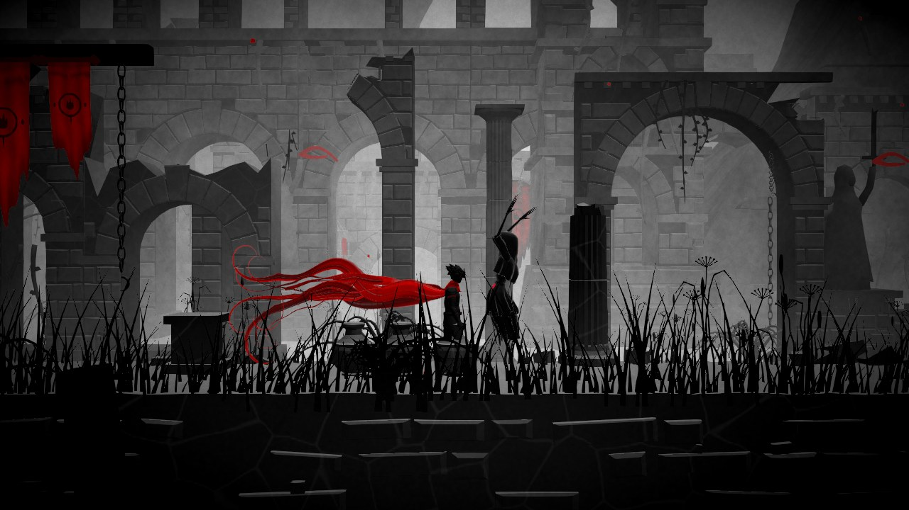

## Vize
- **Vizuál:** černobílý svět v odstínech šedi, vrstvy v mlze, siluety v popředí. Jedinou barvou je **ruda**: šála hrdiny, listí, prapory, oči nepřátel a všechno, na co šála dosáhne.
- **Šála (Veil):** kouzelná látka, která víří jako Kármánova vírová stezka. Na stisk klávesy „ztvrdne“ do zbraně, ale pořád je to tatáž látka napojená na krk a ruku hrdiny. Formy: **bič, meč, kopí, štít, luk**. Je zároveň ukazatelem zdraví: při zranění se ztenčuje, tmavne a třepí.
- **Hratelnost:** extrémně plynulý pohyb, kombo napříč zbraněmi, hádanky a příběh vyprávěný beze slov.
- **Vlastní tvorba:** postavy, prostředí i nepřátelé jsou modelovaní a animovaní v projektu (Blender skripty v `ArtSource/`), bez hotových asset packů. Pohyb hrdiny je procedurální póza, přes kterou se prolíná motion capture převedený na jeho vlastní kostru.

## Svět
| | |
|---|---|
| 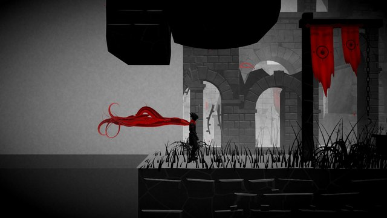 | 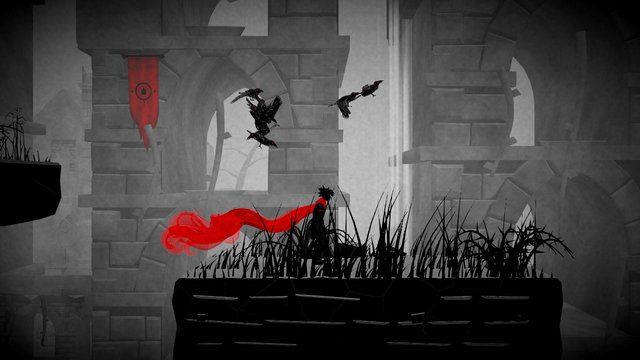 |
| 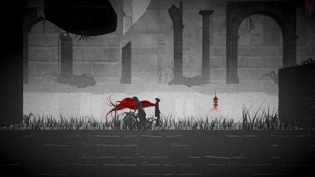 | 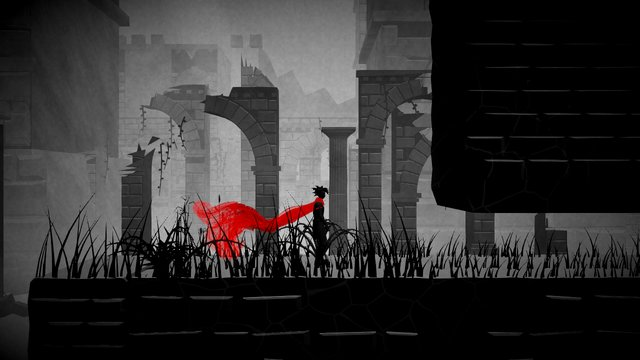 |

## Pohyb a boj
Natočeno přímo ve hře (12 snímků za sekundu, převážně ve zkušební místnosti). Stav k verzi 0.109.

| | |
|---|---|
| **Chůze a běh**: došlap přes patu, krok v tempu klipu<br>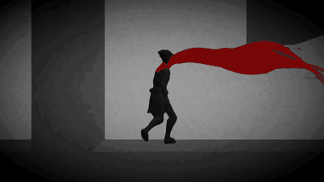 | **Otočka v běhu**: smyk a otočka, dobrzdění v předklonu<br>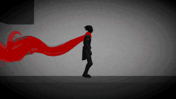 |
| **Skok a salto**: dvojskok se saltem, šála se obtočí kolem těla<br>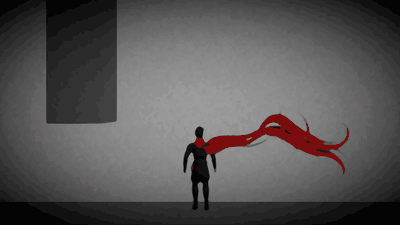 | **Tvrdý dopad** z 10 m do podřepu<br>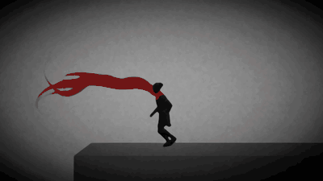 |
| **Kotoul**: po seskoku za běhu ho kotoul nese dál<br>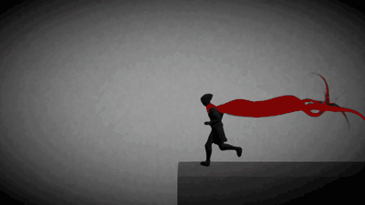 | **Hrana**: chycení prsty přes hranu, visení a vylezení<br>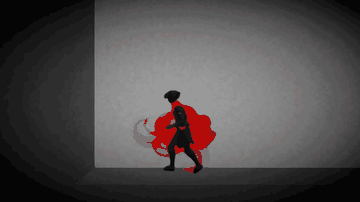 |
| **Plížení** tunelem vysokým 1,35 m<br>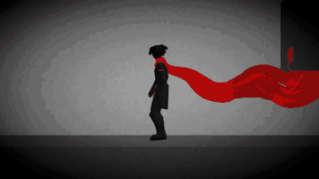 | **Skluz** z běhu rovnou pod strop<br>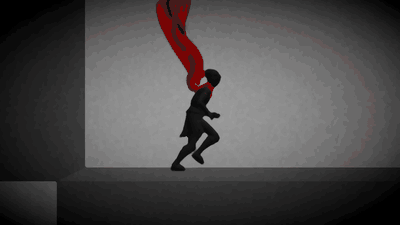 |
| **Dash**: krátký výpad rychlostí 19 m/s<br>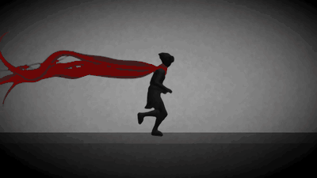 | **Kombo**: dva seky mečem a dokončení kopím<br>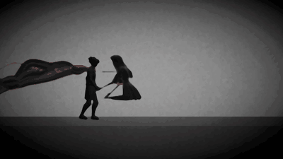 |
| **Bič**: dvě šlehnutí, druhé nízko po zemi<br>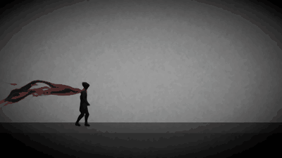 | **Luk**: výstřel na stisk a míření nad hlavu<br>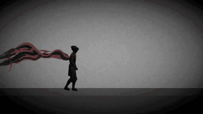 |
| **Štít**: šála se rozvine do kruhu kolem těla<br>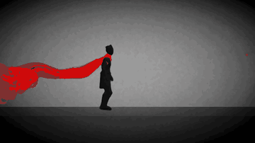 | **Míření**: sek nahoru, úder pod nohy, bodnutí vzhůru<br>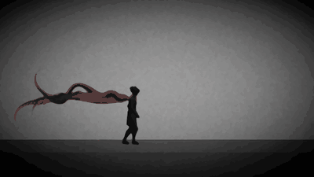 |
| **Houpání na biči**: rozhoupání šipkami, seskok s hybností<br>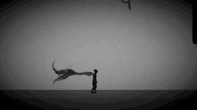 | **Přízrak útočí**: ohlásí útok zábleskem, hrdina se pod ranou zapotácí<br>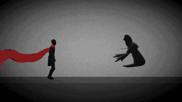 |
| **Šála v klidu**: víry na jejím konci<br>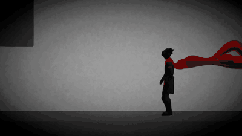 | **Tělo ze tří čtvrtin**: chůze a sek z mocapu<br>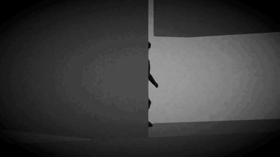 |

## Nepřátelé a bytosti
Všichni jsou postavení znovu na úroveň detailu hrdiny (tvář, ruce s prsty, látka) a každý útok ohlásí stejným karmínovým zábleskem.
| | | |
|---|---|---|
| 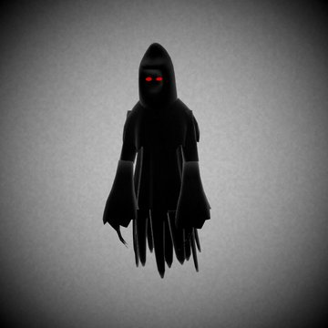<br>**Přízrak**: hlídkuje, pronásleduje, napřáhne drápy a udeří. | 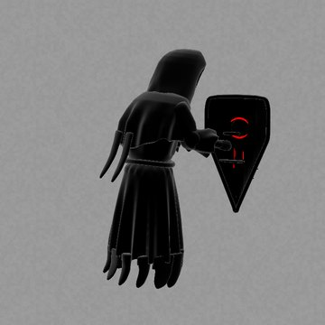<br>**Mnich se štítem**: zepředu nezranitelný, úder se od štítu odrazí. Útočí nárazem štítu a řemdihem. Obejdi ho, nebo mu bičem vytrhni štít. | 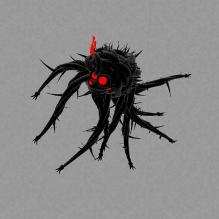<br>**Kořenolez**: visí ze stropu, zachvěje se a seskočí na hrdinu. Kopí ho přišpendlí. |
| 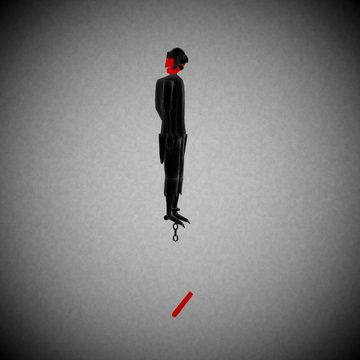<br>**Oběšenec**: houpe se na laně. Přestřel lano a tělo zůstane jako závaží. | 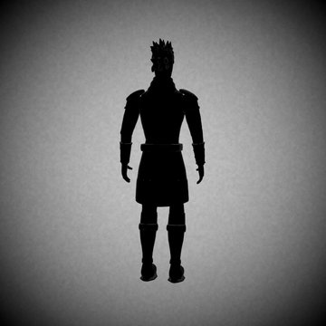<br>**Stínový dvojník**: opakuje hrdinovy pohyby se zpožděním, ale neskáče. Vlákej ho do propasti. | 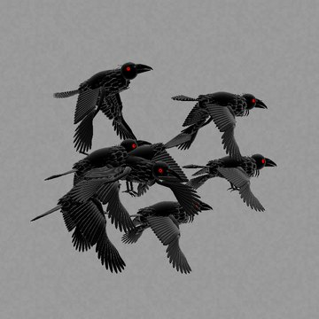<br>**Havraní roj**: krouží nad hrdinou a střemhlav jím prolétá. Bič jich srazí víc najednou, od štítu odletí. |
| 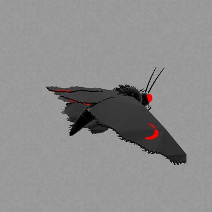<br>**Popelavá můra**: létá vysoko (na luk) a sype popel, který ztlumí šálu. Držený štít ho zadrží. | 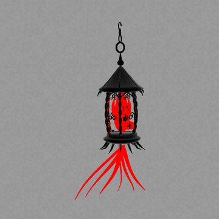<br>**Bludička**: neškodná, ale láká k propastem. Zásah ji chytí a zůstane svítit na místě. | 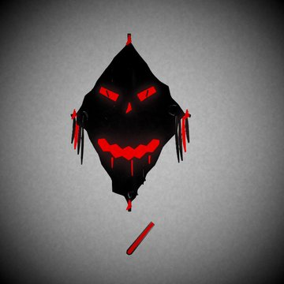<br>**Papírový drak**: létá na niti. Přestřel ji a z jeho látky se dá plachtit (drž skok). |

## Ovládání
Hra startuje do hlavního menu (Hrát, Nastavení, Konec). **Hrát** ukáže kapitoly jako karty s náhledem: **Zkušební místnost** (všechny zbraně, hrany, tunel, kruhy pro bič) a **Kapitola 1: Ruiny pod rudým stromem**. V menu potvrzuje mezerník, Enter nebo A na ovladači, Esc vrací zpět. V **Nastavení** (záložky Ovládání, Zvuk, Obraz) jde každou klávesu i tlačítko ovladače přemapovat a nastavit hlasitost, rozlišení, režim okna, VSync a kvalitu; ve hře otevře **Esc** (Start) pauzu s nastavením. Výchozí rozložení je pro dvě ruce: levá se pohybuje, pravá bojuje.

| Akce | Klávesnice | Gamepad |
|---|---|---|
| Pohyb | A / D | levá páčka |
| Skok (držet = výš, ve vzduchu druhý skok; při pádu znovu a držet = plachtění šálou) | Mezerník | A / South |
| Úskok (ve vzduchu 1× za skok) | Levý Shift | B / East |
| Přikrčení a plížení | S | páčka dolů |
| Skluz | v běhu S + Shift | v běhu páčka dolů + B |
| Mířit nahoru / dolů (sek nahoru, úder pod nohy) | držet W / S při útoku | páčka nahoru / dolů |
| Nízký úder z podřepu (hrdina zůstane dole) | držet S a útok | páčka dolů a útok |
| Výskok s úderem z podřepu (meč, kopí, bič) | z podřepu pustit S, držet W a útok | z podřepu páčka nahoru a útok |
| Stát na místě (míření bez pohybu) | Levý Ctrl | stisk levé páčky |
| Rozhlédnout se nahoru / dolů | E / Q | pravá páčka |
| Obvázat ránu (držet, když je karmínový uzel plný) | R | RB |
| Oltář u checkpointu (vylepšení za karmín) | F | křížový ovladač nahoru |
| Mapa úrovně | Tab | Select / View |
| **Meč** | **U** | X / West |
| **Kopí** | **I** | Y / North |
| **Bič** (u kruhu se chytí a houpe) | **O** | RT |
| **Luk** (stisk = výstřel) | **P** | LB |
| **Štít** (držet) | **J** | LT |
| Pauza / menu | Esc | Start |

Zbraň se seslá a za 0,05 s udeří, ať už ji hrdina drží, nebo se teprve tvoří. Úder ho na chvilku přibije: do konce seku se neotočí ani neodejde. Stisk v posledních 0,3 s úderu naváže další, dřívější stisk naváže, když tlačítko držíš. Údery navazují do komba a mezi údery jde zbraň vyměnit: dokončující úder je tím silnější, čím víc zbraní kombo spojilo. Zbraně se hrdina učí od relikvií na podstavcích (v testovací místnosti vlevo od startu zná všechny). **HUD:** vlevo nahoře jsou životy jako karmínové listy na větvičce tuší. Prázdné místo zůstane jako obrys a žilky dělí list na čtvrtiny. Každý zásah ulomí přesně tolik, kolik vzal, a utržený kus zešedne a opadne. U kořene větvičky je obvaz: každý zásah ho ovine o čtvrtinu, a když je celý a chybí život, slabý karmín na listech ukáže, kolik obvázání (drž R) doplní. Pupen na konci větvičky roste s úlomky a ze čtvrtého se rozvine nový list. Dole uprostřed je síla jako bojová šála: průsvitné pruhy v obloucích s ostrými cípy a vlákny stočenými do spirál. Délka je síla, malé značky nad ní ukazují ceny zbraní. Vpravo dole je počet karmínových kapek.

**Odezva boje:** zasažený nepřítel odskočí a chvíli se vzpamatovává, minutí nechá ve vzduchu stopu inkoustu (bez trestu), úder do štítu se odrazí a hrdina odskočí. Štít blokuje útoky všech nepřátel ze všech stran, a když ho zvedneš přesně ve chvíli úderu (do 0,2 s), útok odrazí a nepřítel zakolísá.

**Zdraví a karmín:** život sám nedorůstá. Údery, které zasáhnou, uvážou karmínový uzel (ukazatel pod zdravím). Když je plný, podržením R hrdina obváže ránu a vrátí si život. Checkpoint doplní život i šálu. Z poražených nepřátel padají karmínové kapky a u oltáře na checkpointu (F) se za ně kupuje delší šála, pevnější obvaz a ostřejší závoj. Čtyři úlomky schované v tajných místech dají život navíc. Po smrti zůstanou kapky ležet na místě a dají se sebrat zpátky. V pauze jde **začít kapitolu znovu**: vrátí se všichni nepřátelé a hrdina je takový, jaký do kapitoly přišel, takže co v ní nasbíral, ztratí. Restartem se tedy nedá grindovat. Vylepšení mají strop podle kapitoly (v první kapitole úroveň 1).

**Kvalita obrazu** (Nastavení → Obraz): Nízká, Střední a Vysoká. Při prvním spuštění se vybere podle grafické karty a v menu je označená „(doporučeno)“. Ve **Vlastní** se dá zvlášť nastavit okolní stínění, vyhlazování hran, rozlišení vykreslování (75–100 %) a stíny.

## Technika
- **Pohyb (`MotorLogic`):** coyote time, jump buffer, variabilní výška skoku, „apex hang“, rychlejší pád, dash i dash-jump se zachováním hybnosti, chycení hrany, plížení, skluz, kotoul po pádu z výšky, houpání na biči, nízký úder z podřepu a výskok s úderem. Logika je oddělená od Unity, takže se dá testovat v EditMode.
- **Šála (`VeilSimulation`):** řetěz Verletových bodů. Tělo hrdiny odtrhává střídavé Lamb-Oseenovy víry s frekvencí podle Strouhalova čísla `f = St·U/D`, takže čím rychleji běží, tím divočeji šála víří. Formy zbraní nastaví cílový tvar a „tvrdost“, ale víry působí dál a zbraň pořád žije.
- **Animace hrdiny:** základem je procedurální póza (`HeroPoseSolver`, `HeroAnimator`). `HeroMocap` přes ni prolíná klipy z motion capture upečené na kostru hrdiny (`HeroMocapBaker`, menu *Crimson Veil > Mocap*). Kontakt se zemí drží chodidla, ruce i tělo na podlaze a kontakt se zdí drží celé tělo mimo zdi, i když se při pohybu vyklání z kolizní kapsle. Obličej má čelist, víčka a obočí pro cutscény (`HeroFace`).
- **Výkon:** v okně 1920 × 1080 asi 350 fps na RTX 2060. Na integrované grafice Intel UHD je to 82 fps na Vysoké, 96 na Střední a 130 na Nízké. Sestavená hra se dá změřit přepínačem `-cvbench` (`Tools/bench.ps1`). Každá část postavy má profilovací značku `CV.*` (`Core/Perf.cs`, okno Profiler ukáže čas i alokace) a test hlídá, že postava za snímek nealokuje žádnou paměť, takže sběrač odpadu nedělá pauzy.
- **Nepřátelé (`Combat/Creatures`):** každá bytost má vlastní chování a procedurální animaci nad modelem z Blenderu. Společný základ (`CreatureBase`) obstará odskok a vzpamatování po zásahu i zakolísání po vykrytí. `CombatFx` obstará ohlášení útoku, minutí a odraz od štítu.
- **Kvalita obrazu (`QualityPresets`, `GameSettings`):** každá úroveň má vlastní URP asset, Vlastní mění svůj asset za běhu.
- **Vizuální styl:** vrstvy hloubky se se vzdáleností noří do mlhy. Finální průchod `InkGrade` hlídá paletu a cokoli, co není výrazně rudé, převede na šeď.

## Struktura
```
Assets/_CrimsonVeil/
  Scripts/Runtime/
    Core/      MovementMath, RigJoint, SpringChainSolver, GameSettings, QualityPresets, Benchmark, Perf
    Player/    MotorLogic, PlayerController, HeroPoseSolver + HeroAnimator, HeroMocap, HeroFace, HeroHands, ClipRecorder
    Veil/      VeilSimulation, VeilController, formy zbraní, VeilCombo, VeilCasting, VeilRelic, renderer, šíp
    Combat/    VeilCombat, PlayerHealth, Enemy (přízrak), Creatures/ (ostatní bytosti), CombatFx
    Camera/    CameraFollow25D, CameraZone, CameraFocus
    World/     TerrainBlock, rekvizity (oblouky, sloupy, tráva, stromy…), GrapplePoint, CuttableRope, HingedBridge,
               Checkpoint, TestRoom, AtmosphereController
    UI/        ScarfHud (LifeLeaves, EnergyScarf), MainMenu, SettingsPanel, PauseMenu, Minimap, PlaytestLog
  Scripts/Editor/  PrototypeSceneBuilder (Crimson Veil > Build Prototype Scene), Level Editor (Ctrl+Shift+L),
                   Level Kit, HeroMocapBaker
  Animations/Hero/ klipy pohybu upečené na kostru hrdiny
  Art/         Hero, Enemy, Ruins (FBX exporty z ArtSource/*.blend)
  LevelKit/    prefaby pro stavbu úrovní
  Tests/EditMode, Tests/PlayMode
ArtSource/     zdrojové .blend soubory a Blender skripty (mimo Assets)
Docs/          obrázky a GIFy pro toto README, poznámky pro vývoj (claude/), předávka a backlog
Tools/         benchmark, hooky předávky mezi počítači, keep-awake
.githooks/     hlídání verzí a CHANGELOGu
```

## Testy
Unity → Window → General → Test Runner: **701 EditMode** a **176 PlayMode** testů. PlayMode testy ověřují každý pohyb a kombo na skutečném prefabu hrdiny (`HeroMoveSetPlayTests`).

## Verze a CHANGELOG
Každý commit má vlastní verzi podle [SemVer](https://semver.org/lang/cs/): sekci `## [X.Y.Z] – RRRR-MM-DD` v [CHANGELOG.md](CHANGELOG.md) a tag `vX.Y.Z`. Hlídají to git hooky v `.githooks/`:
- `pre-commit` nepustí commit bez nové, vyšší verze v CHANGELOGu, s prázdnou sekcí nebo s textem pod `[Unreleased]`;
- `post-commit` označí commit tagem jeho verze;
- `pre-push` nepustí na GitHub commit bez tagu verze nebo bez změny CHANGELOGu.

Po naklonování je jednou zapni:
```
git config core.hooksPath .githooks
git config push.followTags true
```
