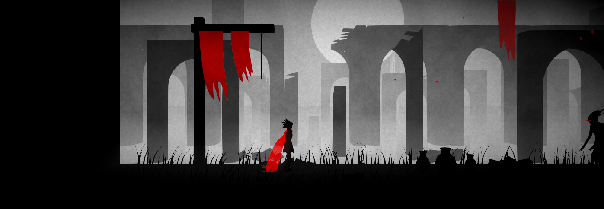

# Crimson Veil

2.5D akční plošinovka v Unity 6.3 (URP). Pohyb a boj ve stylu *Prince of Persia: The Lost Crown*, atmosféra a vyprávění beze slov ve stylu *Limbo*.


## Vize
- **Vizuál:** černobílý svět v odstínech šedi, vrstvy v mlze, siluety v popředí. Jedinou barvou je **ruda** – šála hrdiny, listí, prapory, detaily.
- **Šála (Veil):** kouzelná látka, která víří jako Kármánova vírová stezka. Při pohybu víří víc, na stisk klávesy „ztvrdne“ do zbraně nebo nástroje – ale pořád je to ta samá látka, napojená na krk a ruku hrdiny.
  Formy: **bič, meč, kopí, štít, luk**.
- **Hratelnost:** extrémně plynulý běh a skoky, hádanky, příběh vyprávěný bez dialogů.

## Ovládání (prototyp)
| Akce | Klávesnice | Gamepad |
|---|---|---|
| Pohyb | A/D, šipky | levá páčka |
| Skok (držet = výš) | Mezerník | A / South |
| Dash | Levý Shift | B / East, RB |
| Útok | J, levé tlačítko myši | X / West |
| Mířit nahoru (luk) | držet W / šipku nahoru při útoku | páčka nahoru |
| Bič / Meč / Kopí / Štít / Luk | 1 / 2 / 3 / 4 / 5 (znovu = zpět na látku) | D-pad ← ↑ → ↓, LB |

Bez HUD: zdraví poznáš podle šály, která se při zranění ztenčuje, tmavne a třepí. Rudá v prostředí (provazy, prapory) znamená „tohle šála dosáhne“.

## Struktura
```
Assets/_CrimsonVeil/
  Scripts/Runtime/
    Core/      MovementMath, RigJoint (kalibrace kostí pro procedurální animaci)
    Player/    MotorLogic (logika pohybu), PlayerController (2.5D), HeroPoseSolver + HeroAnimator (procedurální animace), vstupy
    Veil/      VeilSimulation (Verlet + Lamb-Oseen víry), formy zbraní, renderer stuhy, chomáčky, šíp
    Combat/    VeilCombat, PlayerHealth, Enemy + EnemyBrain + EnemyAnimator, CombatFx (hitstop, třes, inkoust)
    Camera/    CameraFollow25D – look-ahead, měkčí sledování ve vzduchu, třes kamery
    World/     ProceduralMeshes (oblouky i rozbité, sutiny, urny, tráva, prapory, strom), Breakable,
               CuttableRope + HingedBridge (hádanka), Checkpoint, AtmosphereController, LeafFall
  Shaders/     Silhouette (inkoust + mlha + vítr), Mist (mlha, paprsky, vodopády), InkGrade (šeď + ruda)
  Art/         Hero/Hero.fbx, Enemy/Wraith.fbx (exporty z ArtSource/*.blend)
  Scripts/Editor/  PrototypeSceneBuilder – menu "Crimson Veil > Build Prototype Scene"
  Tests/EditMode   unit testy pohybu, šály, boje, AI, animace a geometrie
  Tests/PlayMode   integrační testy hráče, boje, hádanky a respawnu
ArtSource/     zdrojové .blend soubory (mimo Assets, Unity je neimportuje)
```

### Vizuální styl
Svět je jen v šedi, jedinou barvou je ruda. Vrstvy hloubky (popředí, hrací plocha, blízké a vzdálené ruiny, nebe) se se vzdáleností noří do přízemní mlhy. Finální průchod `InkGrade` hlídá paletu: cokoli, co není výrazně rudé, převede na šeď.

### Pohyb (`MotorLogic`)
Coyote time, jump buffer, variabilní výška skoku (pustit = rychlejší dopad), „apex hang“ v nejvyšším bodě, rychlejší pád, dash (i ve vzduchu, 1× za skok), dash-jump zachovává hybnost. Vše laditelné v Inspectoru na `PlayerController`.

### Šála (`VeilSimulation`)
- Řetěz Verletových bodů s distančními omezeními.
- Tělo hrdiny odtrhává střídavé víry s frekvencí podle Strouhalova čísla `f = St·U/D` (+ „magický“ klidový základ) – čím rychleji běží, tím divočeji šála víří.
- Každý vír je Lamb-Oseenův (konečná rychlost v jádru, jádro roste difuzí); víry unáší vzduch a postupně slábnou.
- Formy zbraní nastaví cílový tvar a „tvrdost“: body se přitahují k tvaru, délky segmentů se plynule mění, ale víry dál působí – zbraň pořád žije.



## Testy
Unity → Window → General → Test Runner → EditMode / PlayMode (84 EditMode + 11 PlayMode).
